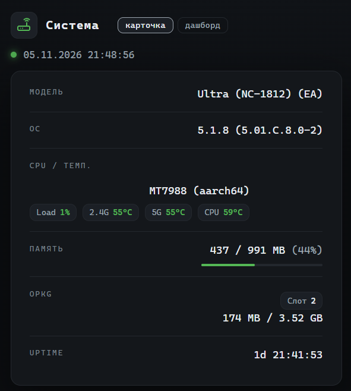
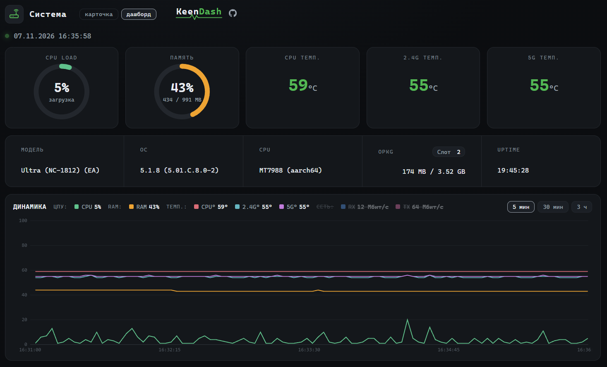

<div align="center">


<div align="left">


Легковесный и красивый системный монитор для роутеров на базе KeeneticOS (в стиле Netdata).


[](LICENSE.txt)

## ✨ Особенности

- ⚡ **Минимальная нагрузка**: Опрос датчиков раз в 3 секунды, загрузка CPU ~1% (Ultra NC-1812).
- 💾 **Бережёт флешку**: Все данные (и текущие, и история графиков) пишутся в оперативную память (`/tmp/keendash`), а веб-сервер читает их через симлинк. Износ накопителя равен нулю.
- 📊 **Графики на всех устройствах**: История графиков (3 часа) копится на роутере в оперативке построчным JSON (~260 КБ) и отдаётся одним файлом. Открой дашборд с телефона, планшета или нового браузера — график везде одинаковый.
- 🌐 **Скорость сети RX/TX**: синяя и розовая кривые на отдельной правой шкале Мбит/с с авто-масштабированием.
- 🖱 **Кликабельная легенда**: клик по разделу (ЦПУ / RAM / Темп. / Сеть) или отдельной кривой — показать/скрыть, двойной клик — оставить только выбранное. Выбор запоминается браузером.
- 🧠 **Умный установщик**: KeenDash поднимает **свой собственный веб-сервер на выделенном порту 8321** (конфиг `/opt/etc/keendash/lighttpd.conf`). Если lighttpd в Entware нет — установщик сам его поставит. Совсем ничего не вышло — возьмёт встроенный в KeeneticOS busybox httpd. В конце сам проверяет по HTTP, что страница реально отдаётся.
- 🔄 **Переживает перезагрузку**: хук `200-keendash.sh` при старте роутера проверяет порт и сам поднимает и демон, и веб-сервер.
- 🗂 **Всё в своей папке**: Веб-страницы живут в подпапке `keendash` внутри корня веб-сервера, скрипты — в `/opt/etc/keendash`. Проект не перемешивается с системными файлами, чужие файлы не затирает и удаляется одной командой.
- 📦 **Установка и удаление одной командой**.

---
## 📸 Скриншоты

**Карточка** (`index.html`) — компактный вид для быстрой проверки состояния:



**Дашборд** (`dash.html`) — индикаторы и графики нагрузки, памяти, температур и скорости сети (RX/TX) за 3 часа:



---

## ⚙️ Как это работает (простыми словами)

1. **Сборщик (`/opt/etc/keendash/sysinfo.sh`)**: Каждые 3 секунды быстро считывает температуру, память и загрузку CPU. Текущие значения пишет в `/tmp/keendash/data.json`, а заодно дописывает одну строку в историю `/tmp/keendash/sysinfo-history.json` (хранится 3600 точек = 3 часа).
2. **Свой веб-сервер (`/opt/etc/keendash/lighttpd.conf`)**: lighttpd работает с корнем `/opt/share/www` и отдаёт папку `keendash` на порту 8321. Чужие конфиги (nginx, системный lighttpd, панели) не затрагиваются.
3. **Симлинки**: В папке `keendash` лежат не настоящие файлы, а ярлыки на файлы в оперативке. Веб-сервер их отдаёт, флешка не трогается.
4. **Хук автозапуска (`/opt/etc/ndm/netfilter.d/200-keendash.sh`)**: при загрузке роутера проверяет порт и поднимает демон и веб-сервер.
5. **Браузер**: Страница каждые 3 секунды забирает `data.json` (текущие значения). При открытии дашборд один раз загружает историю из `sysinfo-history.json` — поэтому график виден сразу и с любого устройства. После перезагрузки роутера история начинается заново (это нормально для мини-дашборда).

### 📁 Где что лежит

```
<корень веб-сервера>/keendash/       ← веб-страницы (+2 симлинка в оперативку)
/opt/etc/keendash/sysinfo.sh         ← сборщик данных
/opt/etc/keendash/lighttpd.conf      ← конфиг собственного веб-сервера (порт 8321)
/opt/etc/keendash/install.env        ← сервер, папка, порт и готовый адрес
/opt/etc/ndm/netfilter.d/200-keendash.sh  ← автозапуск демона и веб-сервера
/tmp/keendash/                       ← данные в оперативке (очищается при ребуте)
/var/run/keendash.pid                ← pid демона
```

По умолчанию корень — `/opt/share/www` (туда установщик кладёт папку
`keendash`). Если установщик переиспользовал твой уже работающий nginx или
lighttpd, корень будет другим — точный путь всегда в `install.env`.

---

## 🚀 Установка

Подключись к роутеру по SSH (через PuTTY, Terminal или встроенную консоль) и выполни одну команду:

```sh
curl -fLsS "https://raw.githubusercontent.com/YaPA24/KeenDash/main/install.sh" | sh
```

Скрипт автоматически скачает все файлы, поднимет веб-сервер, расставит симлинки в оперативную память и запустит фоновый сбор данных.

### 🌐 Как открыть

В конце установки скрипт печатает **готовый адрес**.

```
http://192.168.1.1:8321/keendash/
```
Переключение «карточка ↔ дашборд» — кнопками в шапке страниц.

- **Карточка**: `http://IP-роутера:8321/keendash/index.html`)
- **Дашборд с графиками**: `http://IP-роутера:8321/keendash/dash.html`

Выделенный порт KeenDash 8321. Если порт занят,
установщик возьмёт следующий свободный и напечатает точный адрес;
переустановка адрес не меняет. Посмотреть его всегда можно на роутере:

```sh
cat /opt/etc/keendash/install.env
```

---

## 🗑 Удаление

Чтобы полностью удалить KeenDash (остановить демон и его веб-сервер, удалить файлы и очистить временные данные), выполни:

```sh
curl -fLsS "https://raw.githubusercontent.com/YaPA24/KeenDash/main/uninstall.sh" | sh
```
После этой команды и перезагрузки роутера от проекта не останется никаких следов.

---

## 🙏 Благодарности

Проект вдохновлён лучшими практиками из:
- [Netdata](https://github.com/netdata/netdata) (концепция дашборда и графиков)
- [KeenKit](https://github.com/spatiumstas/KeenKit) (методы получения данных о модели и SoC Keenetic)
- [awg-manager](https://github.com/hoaxisr/awg-manager) (подход к сбору системной информации)


---
*Сделано с ❤️ для сообщества Keenetic.*
